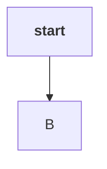

# Guide

## Setup

First setup section.

## Setup

Second setup section.

## Заголовок по-русски

<a id="custom-anchor"></a>

<script>window.injected = true;</script>


[bad link](<javascript:alert(1)>)

<details><summary>More</summary>

Hidden text.

</details>




```ts
const answer: number = 42;
```

- [x] done item
- [ ] open item
